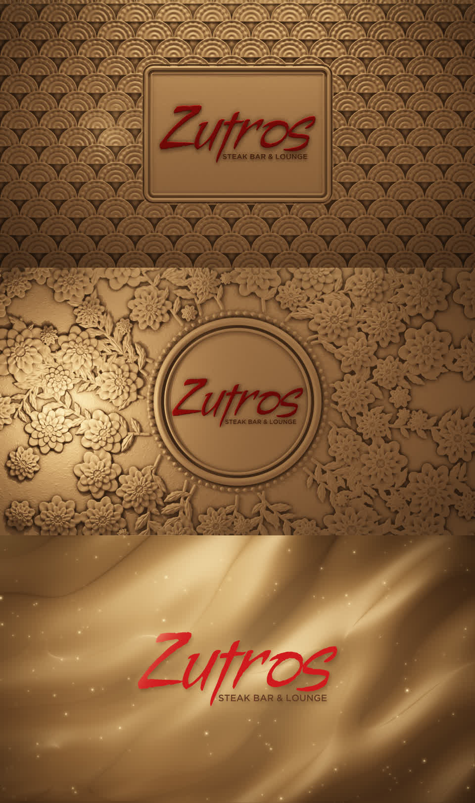

# VFX Zutros

Loops VFX para Zutros Steak Bar & Lounge, para Resolume Arena.



> Los archivos **HAP (.mov)** para el show están en la sección **Releases** de este repo (pesan más de 100 MB, que es el límite de GitHub por archivo). Aquí están los MP4 de vista previa en `previews_mp4/`.

## Cómo cargarlos en Resolume Arena

## Qué hay
| Loop | Estilo | Movimiento |
|---|---|---|
| `Zutros_deco` | Pared Art Deco de abanicos con placa central | Dos spots cálidos que se mueven de lado a lado y un brillo que cruza la pared |
| `Zutros_floral` | Pared tallada de flores y hojas con medallón central (el más parecido al ejemplo) | La luz gira alrededor del medallón y las sombras se mueven |
| `Zutros_seda` | Seda champán ondulando con polvo dorado | La tela se mueve, las partículas flotan y un brillo pasa sobre el logo |

Cada uno viene en dos versiones: con logo (`_LOGO`) y sin logo, para poner tu propio logo o texto como capa encima.
Todos son 1920x1080, 30 fps, 10 s, y el último cuadro empalma con el primero (loop sin costura).

## Formatos
- Releases → `*_HAP.mov`: **usa estos en el show.** HAP se decodifica en la GPU, igual que DXV, y Resolume lo reproduce de forma nativa.
- `previews_mp4/*.mp4`: livianos, para verlos en el celular o mandarlos al cliente.
- Si quieres DXV: arrastra los .mov a **Resolume Alley** → Convert → DXV3 (Normal Quality).

## Cargar y probar
1. Arrastra el `.mov` HAP a un clip de la deck.
2. En el clip: Transport → **Loop** (viene por defecto). Mira el salto de 10 s a 0 s; no debería notarse.
3. Si la pantalla no es 16:9, en el panel del clip usa *Fill* o *Fit* según el caso.
4. Para cambiar la velocidad: el control **Speed** del clip. Con 0.5x queda más lento y elegante.
5. Para la versión sin logo + tu logo: pon el PNG del logo en la capa de arriba (Blend: Alpha).

## Ideas rápidas en Resolume
- Colorize / Hue Rotate leve para noches temáticas.
- Brightness/Contrast más bajos en horario de cena y más altos en el lounge de la noche.

`script/zutros_vfx.py` genera todos los loops (Python + numpy + opencv). Con él puedo sacar más variantes, otra resolución (por ejemplo 4K o el tamaño exacto de tu pantalla LED) o el logo blanco/negro.

### Regenerar
```bash
pip install numpy opencv-python-headless
python script/zutros_vfx.py floral 1920 1080 300 Zutros_floral_LOGO logos/Logo_Zutros_rojo.png   # escena: deco | floral | seda
python script/zutros_vfx.py floral 1920 1080 still prueba   # 3 imágenes de prueba
```
Necesita ffmpeg con el encoder `hap`.
