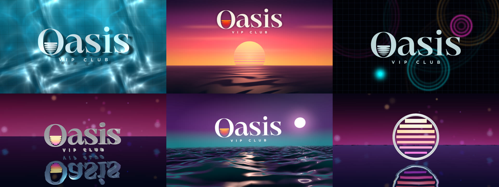

# VFX Oasis VIP Club

Loops para la pantalla de Oasis VIP Club (piscina, club, terraza y discoteca), pensados para Resolume Arena.

- **1920x1080, 30 fps, 10 s (300 frames)**, loop sin costura: todo el movimiento depende de una fase `p = 2π·t/10`, así que el último frame enlaza perfecto con el primero.
- Cada escena viene **con logo** (`_LOGO`) y **sin logo** (para mezclar o poner otro texto encima).
- **HAP .mov** para Resolume (decodifica en la GPU) y **MP4 H.264** para verlos en el teléfono.



## Escenas

| Escena | Tipo | Idea | Cuándo usarla |
|---|---|---|---|
| `caustica` | 2D (shader) | Fondo de piscina turquesa con cáusticas, azulejos y rayos de sol. El logo flota y proyecta su sombra en el fondo. | Día / pool party |
| `atardecer` | 2D (shader) | Sol caribeño a rayas (igual que la O del logo) bajando al mar, reflejo que tiembla. El logo lleva las franjas de la O en colores de atardecer. | Sunset, terraza |
| `neon_ondas` | 2D (shader) | Gotas que caen en el agua **a 120 BPM** (20 golpes por loop) con anillos neón cian, magenta y oro. El halo del logo cambia de color cada 4 golpes. | Discoteca, pico de la noche |
| `logo_espejo` | 3D (three.js) | Logo extruido en cromo con la O encendida en colores de atardecer, flotando sobre agua espejo de noche, luces de club que barren y bokeh. Sin logo: un sol a rayas en un aro de cromo que gira. | Intro, entrada VIP |
| `olas_3d` | 3D (three.js) | Mar tropical de noche con olas 3D, luna y horizonte turquesa. El logo flota sobre el horizonte y deja un camino de luz en el agua. | Lounge, ambiente |

`neon_ondas` va a 120 BPM. Si el DJ pone otro tempo, en Resolume ajusta la velocidad del clip (BPM Sync → 120 en el clip y que siga el BPM master).

## Archivos

- `previews_mp4/` – MP4 H.264 para ver en el teléfono (también sirven en Resolume, pero el HAP rinde mejor).
- `codigo/logos/` – el logo original y versiones preparadas: blanco transparente, negro transparente, blanco con la O en degradado atardecer, y `oasis_glow.png` (alfa + halo para efectos neón).
- `codigo/` – todo el código para volver a renderizar o crear escenas nuevas.
- `HAP_Resolume/` – HAP **con logo** listos para Resolume. Los de más de 95 MB vienen partidos (`.parte00`, `.parte01`…): descarga el repo y haz doble clic en `UNIR_VIDEOS.bat` (Mac/Linux: `sh unir_videos.sh`). Los HAP sin logo están en la carpeta del proyecto de Claude (`oasis/HAP_para_Resolume`).

## Resolume Arena

1. Arrastra los `.mov` HAP a una capa (Resolume los reconoce directo, no hay que convertirlos).
2. Clip → Transport: **Loop**. Duración 10 s.
3. Si tu pantalla no es 16:9, en Clip → Transform usa *Fill* o *Fit*, o pídeme el render con la resolución exacta.
4. Si prefieres DXV: abre el HAP en **Resolume Alley** y conviértelo a DXV3.

## Renderizar de nuevo

Requisitos: Node 18+, `npm i three@0.170.0 playwright`, ffmpeg con encoder HAP, Python 3 con `opencv-python-headless` y `numpy` (solo para preparar el logo).

```bash
cd codigo && npm install
python3 trace.py logos/oasis_logo_original.png   # regenera logos y logo_shapes.json (vectores para el 3D)
python3 -m http.server 8765 &                     # sirve las escenas
node render.mjs atardecer 1 still prueba 960 540  # 3 fotos de prueba
./lote.sh caustica atardecer neon_ondas logo_espejo olas_3d   # render completo con y sin logo -> ../out/
```

Cada escena es un HTML + JS en `codigo/escenas/`. Se ve en vivo en el navegador abriendo
`http://127.0.0.1:8765/escenas/atardecer.html?logo=1&vivo=1` (con GPU real corre en tiempo real).
Parámetros por URL: `logo=0|1`, `vivo=1`, `w`, `h`, `dur`. El renderer usa `seek(t)` para capturar frame a frame.
