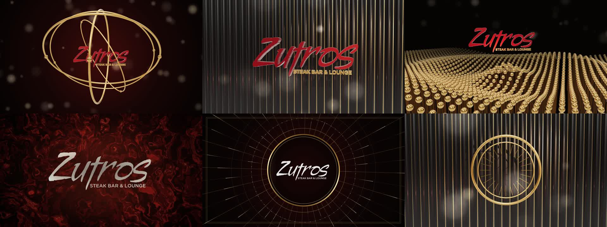

# VFX Zutros v2 (2D y 3D)

| Loop | Tipo | Qué hace |
|---|---|---|
| `anillos` | 3D | Anillos de oro tipo giroscopio girando alrededor del logo en relieve, bokeh cálido |
| `logo_luz` | 3D | Logo extruido (rojo vino lacado + oro) frente a una pared acanalada negra con filos dorados; un spot lo barre |
| `pines` | 3D | Campo de perlas de oro ondulando, logo flotando encima |
| `humo_vino` | 2D | Humo/terciopelo rojo vino con vetas doradas y destellos, logo blanco con brillo |
| `deco_oro` | 2D | Sunburst art deco dorado con pulsos de luz, logo en medallón |

Cada uno con logo (`_LOGO`) y sin logo. 1920x1080, 30 fps, 10 s, loop sin costura.
Los HAP (.mov) para Resolume van en Releases (pesan más de 100 MB).

Código: `codigo/escenas/*.js` (three.js), render cuadro a cuadro con Chrome headless: `node codigo/render.mjs <escena> <1|0> 300 salida` (servir la carpeta en http://127.0.0.1:8765 con `three` instalado en `node_modules`).
