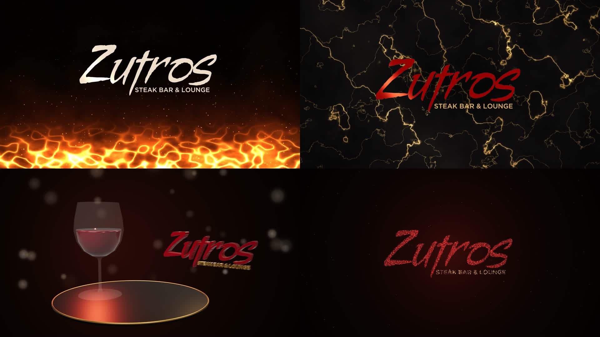

# VFX Zutros v3

| Loop | Tipo | Qué hace |
|---|---|---|
| `brasas` | 2D | Brasas de parrilla encendidas abajo y chispas subiendo; logo blanco con brillo |
| `marmol` | 2D | Mármol negro con vetas de oro que fluyen y un reflejo pulido; logo rojo con texto dorado |
| `copa` | 3D | Copa de vino tinto sobre base negra con aro de oro, cámara en arco y bokeh; logo 3D al lado |
| `particulas` | 2D | Polvo dorado que gira, forma el logo, brilla y se vuelve a dispersar (solo con logo) |

1920x1080, 30 fps, 10 s, loop sin costura. Los HAP (.mov) van en Releases.
